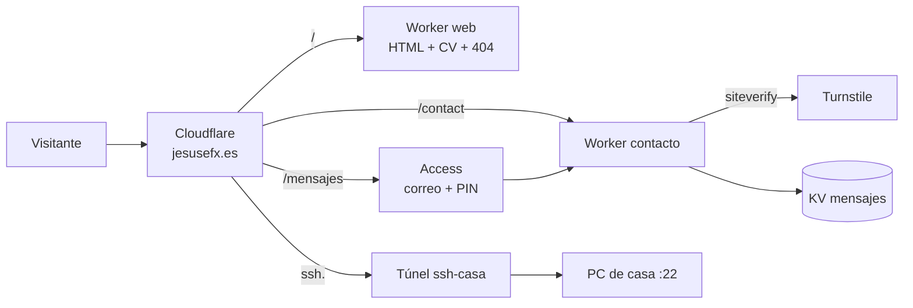

# Mi dominio `jesusefx.es` y Cloudflare

Documento de trabajo donde recojo cómo monté el dominio, qué servicios de Cloudflare uso, por qué tomé cada decisión y qué hice cuando algo falló. Está escrito en primera persona y pensado para publicarlo en el repositorio del sitio.

> **Nota:** las claves privadas (secreto de Turnstile, token del túnel, correo de Access) no aparecen aquí. Viven en Cloudflare y en mi equipo.

---

## 1. Qué tengo y para qué

Compré `jesusefx.es` en DonDominio y lo puse bajo Cloudflare para tres cosas:

1. **Una web propia** en el dominio raíz, de momento una portada «en construcción» con mi CV y un formulario de contacto.
2. **Un buzón privado** donde leer los mensajes que llegan por ese formulario.
3. **Un túnel SSH** para entrar al PC de casa desde cualquier red, incluida la del aula, que bloquea Tailscale.

Todo con el plan gratuito.

---

## 2. Arquitectura



| Nombre | Qué hace |
|---|---|
| `jesusefx.es` | Portada estática servida por el Worker `web` |
| `www.jesusefx.es` | Redirección 301 a la raíz |
| `jesusefx.es/cv.pdf` | Mi CV |
| `jesusefx.es/*` | Página 404 propia |
| `api.jesusefx.es/contact` | Formulario (Turnstile + KV) |
| `api.jesusefx.es/mensajes` | Lista de mensajes, protegida con Access |
| `ssh.jesusefx.es` | Túnel SSH al PC de casa |

---

## 3. Decisiones y por qué

- **Mover los nameservers a Cloudflare.** DonDominio se queda como registrador; Cloudflare gestiona el DNS, el túnel y el control de acceso. El cambio se hace una vez y no afecta a la renovación.
- **Quitar el parking de DonDominio.** Tenía un `A` al parking, un `CNAME *` y un `CNAME www`. El comodín hacía que cualquier subdominio, incluido `ssh.`, resolviera al parking. Lo eliminé para que los errores se vean en vez de quedar tapados.
- **Túnel en lugar de abrir puertos.** El túnel es una conexión saliente; no hay puertos abiertos en el router ni en el Beryl. Funciona en redes que bloquean otros protocolos porque usa el 443.
- **Access delante del túnel.** Aunque el SSH ya exige clave, Access añade una capa de autenticación por correo con PIN y caducidad de 24 h.
- **El formulario va a un subdominio (`api.`).** Las rutas de Worker sobre un dominio de Pages no son fiables; un Worker con dominio propio en `api.jesusefx.es` funciona sin ambigüedades. El CORS se resuelve en el propio Worker.
- **El comodín `*` no se usa.** Fue el origen del último incidente (sección 6).
- **Una KV por servicio.** `mensajes` guarda los envíos del formulario; es de la cuenta y se vincula solo al Worker que la usa.

---

## 4. Puesta en marcha

### 4.1 Dominio y nameservers

1. Añadí el sitio en Cloudflare y copié los dos nameservers asignados.
2. En DonDominio, **DNS → Editar servidores DNS**, sustituí los suyos por los de Cloudflare.
3. Comprobé la delegación con `dig NS jesusefx.es` y con `dig +trace`.
4. Tardó en propagarse; el registro `.es` seguía devolviendo los antiguos hasta que el registrador envió el cambio.

### 4.2 Limpieza del parking

Borré en Cloudflare el `A` del apex, el `CNAME *` y el `CNAME www`. Dejé el `TXT` del SPF.

### 4.3 Túnel SSH

```sh
cloudflared tunnel login
cloudflared tunnel create ssh-casa
cloudflared tunnel route dns ssh-casa ssh.jesusefx.es
```

`~/.cloudflared/config.yml`:

```yaml
tunnel: <UUID>
credentials-file: /home/jesusefx/.cloudflared/<UUID>.json

ingress:
  - hostname: ssh.jesusefx.es
    service: ssh://localhost:22
  - service: http_status:404
```

Servicio del sistema `cloudflared-ssh.service` con `Restart=on-failure`.

### 4.4 Access para SSH

Aplicación autoalojada sobre `ssh.jesusefx.es`, política **Allow** por correo, login con **PIN de un solo uso**, sesión de 24 h.

### 4.5 Web estática

Subí una carpeta con `index.html`, `404.html` y `cv.pdf` mediante **Workers & Pages → Create → Upload and deploy**. Cloudflare crea un Worker de activos estáticos y le asocia el dominio raíz.

### 4.6 Redirección `www`

- Registro `A www → 192.0.2.1` (proxied). Es una IP reservada para documentación: no hay servidor detrás.
- Regla **Single Redirect**: `https://www.*` → `https://${1}`, código 301.

La IP ficticia funciona porque la redirección se ejecuta en el borde y la petición nunca llega al origen.

### 4.7 Formulario: Turnstile, KV y Worker

1. **Turnstile**: widget gestionado para `jesusefx.es` y `api.jesusefx.es`. La *Site Key* va en el HTML; la *Secret Key* es un secreto del Worker.
2. **KV**: namespace `mensajes`.
3. **Worker `contacto`** con dominio personalizado `api.jesusefx.es`:
   - `POST /contact`: valida los campos, verifica Turnstile contra `siteverify`, guarda en KV.
   - `GET /mensajes`: renderiza la lista.
   - CORS limitado a `https://jesusefx.es`.
4. Bindings: `MENSAJES` (KV) y `TURNSTILE_SECRET` (secreto).

### 4.8 Access para los mensajes

Aplicación autoalojada `api.jesusefx.es` **ruta `/mensajes`**, política Allow por correo. La ruta es imprescindible: si se protege todo `api.`, el formulario deja de funcionar para los visitantes.

---

## 5. Inventario

### DNS

| Tipo | Nombre | Destino | Proxy |
|---|---|---|---|
| Worker | `jesusefx.es` | Worker `web` | Proxied |
| A | `www` | `192.0.2.1` | Proxied |
| Tunnel | `ssh` | Túnel `ssh-casa` | Proxied |
| Worker | `api` | Worker `contacto` | Proxied |
| TXT | `jesusefx.es` | `v=spf1 include:spf.dondominio.com` | DNS only |

### Workers y datos

| Recurso | Nombre | Notas |
|---|---|---|
| Worker | `web` | Activos estáticos del sitio |
| Worker | `contacto` | API del formulario |
| KV | `mensajes` | Vinculada como `MENSAJES` |
| Secreto | `TURNSTILE_SECRET` | Solo en `contacto` |
| Turnstile | widget `jesusefx.es` | Modo gestionado |

### Access

| Aplicación | Destino | Política |
|---|---|---|
| `ssh` | `ssh.jesusefx.es` | Allow por correo, PIN, 24 h |
| `Mensajes` | `api.jesusefx.es/mensajes` | Allow por correo, 24 h |

---

## 6. Incidentes y cómo los resolví

### 6.1 El comodín se comió el túnel

**Síntoma:** `ssh casa-cf` dejó de funcionar con `websocket: bad handshake`. Access respondía 302 sin token, pero con token el borde devolvía **404**.

**Causa:** al desplegar la web, el flujo de Cloudflare creó un dominio personalizado `*.jesusefx.es` asociado al Worker `web`. Ese comodín interceptaba `ssh.jesusefx.es` antes de llegar al túnel.

**Solución:** quitar el dominio personalizado `*` (no se puede borrar desde DNS: hay que hacerlo en **Worker → Dominios** o en **Rutas de Workers**) y volver a añadir `jesusefx.es` como dominio personalizado. Tras ello, el WebSocket devolvió **101**.

### 6.2 Access no protegía `/mensajes`

**Síntoma:** `GET /mensajes` devolvía 200 con la lista.

**Causa:** la aplicación se creó sin destino registrado (la vista previa mostraba «0 destinos»).

**Solución:** añadir el nombre de host público `api.jesusefx.es` con ruta `/mensajes` y comprobar en la vista previa que aparecía **1 destino** antes de guardar.

### 6.3 Caché negativa de DNS

**Síntoma:** tras quitar y volver a añadir el dominio raíz, `dig jesusefx.es` devolvía vacío y `curl` no resolvía, aunque `dig @1.1.1.1` sí respondía.

**Causa:** el resolver local (systemd-resolved y el Beryl) había cacheado el NXDOMAIN.

**Solución:** `resolvectl flush-caches` y reinicio de dnsmasq/AdGuard en el router. El TTL negativo puede durar hasta 30 minutos.

### 6.4 Detalles menores

- `curl` no puede probar el WebSocket sobre HTTP/2; hay que forzar `--http1.1`.
- Al reiniciar AdGuard en el Beryl aparecen muchos avisos de `fw3`/`ETHERNET_TTL`: son ruido del firmware GL.iNet, no un fallo del cortafuegos.
- `api.jesusefx.es/contact` en el navegador devuelve `{"error":"metodo"}`: es correcto, solo acepta POST.

---

## 7. Mantenimiento

### Actualizar la web

Edito `index.html`, `404.html` o `cv.pdf` y hago **Create deployment → Upload assets** en el Worker `web`. El dominio no cambia.

### Cambiar el aspecto del formulario

La Site Key está en el HTML; la Secret Key, en el secreto del Worker. Si roto el widget en Turnstile, actualizo las dos.

### Comprobaciones periódicas

```sh
curl -sI https://jesusefx.es | head -1
curl -sI https://www.jesusefx.es | grep -i location
curl -s https://api.jesusefx.es/ -w ' [%{http_code}]\n'
dig ssh.jesusefx.es +short
systemctl is-active cloudflared-ssh
```

### Túnel

```sh
cloudflared tunnel info ssh-casa
journalctl -u cloudflared-ssh -n 30 --no-pager
```

Si el túnel cae, el servicio lo reinicia solo. Si el hostname deja de responder pero Access sigue dando 302, reviso primero que no haya vuelto a aparecer un dominio comodín en el Worker `web`.

### Copias

- El `index.html`, el `404.html` y el `worker.js` están en este repositorio.
- La configuración del túnel y el JSON de credenciales viven en el PC de casa, fuera del repositorio.

---

## 8. Seguridad

- La clave privada del túnel (`<UUID>.json`) no se publica.
- La `TURNSTILE_SECRET` es un secreto del Worker, no una variable de texto.
- Access protege `ssh.` y `/mensajes`; `/contact` queda público a propósito, con Turnstile y validación en servidor.
- La clave SSH del aula va en un USB y se copia a `/tmp`, nunca a una carpeta permanente.
- No hay puertos abiertos en el router.

---

## 9. Coste

Todo dentro del plan gratuito: Pages/Workers (100 000 peticiones/día), KV (1 GB), Turnstile y Access (hasta 50 usuarios). El único gasto recurrente es el dominio.

---

## 10. Pendientes

- Enviar el primer mensaje real y comprobar el listado.
- Valorar un formulario con más campos o un aviso por correo cuando llegue un mensaje.
- Revisar la página cuando quiera publicar contenido de verdad (blog, proyectos, CV actualizado).
- Mover el sitio a un repositorio con despliegue automático por Git si empiezo a cambiar el HTML a menudo.

---

## 11. Comandos de referencia

```sh
# DNS
dig jesusefx.es +short
dig NS jesusefx.es +short
dig +trace NS jesusefx.es

# Túnel
cloudflared tunnel list
cloudflared tunnel info ssh-casa
cloudflared tunnel route dns ssh-casa ssh.jesusefx.es

# Servicio del túnel
sudo systemctl restart cloudflared-ssh
journalctl -u cloudflared-ssh -n 50 --no-pager

# SSH por Cloudflare
ssh casa-cf
ssh -o ProxyCommand="cloudflared access ssh --hostname %h" jesusefx@ssh.jesusefx.es

# Caché de DNS
sudo resolvectl flush-caches
```

---

## 12. Contenido del repositorio

| Archivo | Qué es |
|---|---|
| `index.html` | Portada del sitio |
| `404.html` | Página de error |
| `cv.pdf` | Currículum descargable |
| `worker.js` | Worker del formulario y del listado |
| `DESPLIEGUE.md` | Pasos para publicar cambios |
| `LICENSE` | Licencia MIT |
