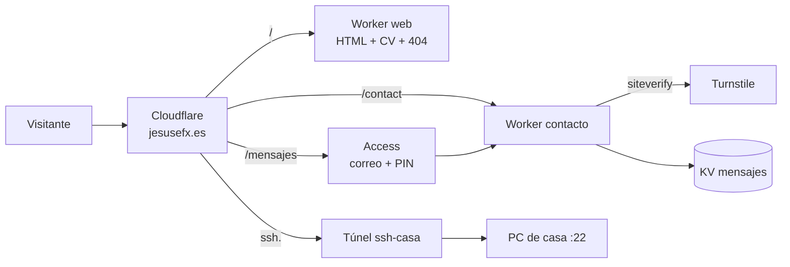

# Mi dominio `jesusefx.es` y Cloudflare

Documento de trabajo donde recojo cómo monté el dominio, qué servicios de Cloudflare uso, por qué tomé cada decisión y qué hice cuando algo falló. Está escrito en primera persona y pensado para publicarlo en el repositorio del sitio.

> **Convenciones:** el dominio es el real; los usuarios y las rutas internas aparecen como marcadores (`<usuario>`).

> **Nota:** las claves privadas (secreto de Turnstile, token del túnel, correo de Access) no aparecen aquí. Viven en Cloudflare y en mi equipo.

---

## 1. Qué tengo y para qué

Compré el dominio en DonDominio y lo puse bajo Cloudflare para tres cosas:

1. **Una web propia** en el dominio raíz, de momento una portada «en construcción» con mi CV y un formulario de contacto.
2. **Un buzón privado** donde leer los mensajes que llegan por ese formulario.
3. **Un túnel SSH** para entrar al PC de casa desde cualquier red, incluida la del aula, que bloquea Tailscale.

Todo con el plan gratuito.

---

## 2. Arquitectura



| Nombre | Qué hace |
|---|---|
| `jesusefx.es` | Portada estática servida por el Worker `web` |
| `www.jesusefx.es` | Redirección 301 a la raíz |
| `jesusefx.es/*` | Página 404 propia |
| `api.jesusefx.es/contact` | Formulario (Turnstile + KV) |
| `api.jesusefx.es/mensajes` | Lista de mensajes, protegida con Access |
| `ssh.jesusefx.es` | Túnel SSH al PC de casa |

---

## 3. Decisiones y por qué

- **Mover los nameservers a Cloudflare.** DonDominio se queda como registrador; Cloudflare gestiona el DNS, el túnel y el control de acceso. El cambio se hace una vez y no afecta a la renovación.
- **Quitar el parking de DonDominio.** Tenía un `A` al parking, un `CNAME *` y un `CNAME www`. El comodín hacía que cualquier subdominio, incluido `ssh.`, resolviera al parking. Lo eliminé para que los errores se vean en vez de quedar tapados.
- **Túnel en lugar de abrir puertos.** El túnel es una conexión saliente; no hay puertos abiertos en el router ni en el Beryl. Funciona en redes que bloquean otros protocolos porque usa el 443.
- **Access delante del túnel.** Aunque el SSH ya exige clave, Access añade una capa de autenticación por correo con PIN y caducidad de 24 h.
- **El formulario va a un subdominio (`api.`).** Las rutas de Worker sobre un dominio de Pages no son fiables; un Worker con dominio propio en `api.jesusefx.es` funciona sin ambigüedades. El CORS se resuelve en el propio Worker.
- **El comodín `*` no se usa.** Fue el origen del último incidente (sección 6).
- **Una KV por servicio.** `mensajes` guarda los envíos del formulario; es de la cuenta y se vincula solo al Worker que la usa.

---

## 4. Puesta en marcha

### 4.1 Dominio y nameservers

1. Añadí el sitio en Cloudflare y copié los dos nameservers asignados.
2. En DonDominio, **DNS → Editar servidores DNS**, sustituí los suyos por los de Cloudflare.
3. Comprobé la delegación con `dig NS jesusefx.es` y con `dig +trace`.
4. Tardó en propagarse; el registro `.es` seguía devolviendo los antiguos hasta que el registrador envió el cambio.

### 4.2 Limpieza del parking

Borré en Cloudflare el `A` del apex, el `CNAME *` y el `CNAME www`. Dejé el `TXT` del SPF.

### 4.3 Túnel SSH

```sh
cloudflared tunnel login
cloudflared tunnel create ssh-casa
cloudflared tunnel route dns ssh-casa ssh.jesusefx.es
```

`~/.cloudflared/config.yml`:

```yaml
tunnel: <UUID>
credentials-file: /home/<usuario>/.cloudflared/<UUID>.json

ingress:
  - hostname: ssh.jesusefx.es
    service: ssh://localhost:22
  - service: http_status:404
```

Servicio del sistema `cloudflared-ssh.service` con `Restart=on-failure`.

### 4.4 Access para SSH

Aplicación autoalojada sobre `ssh.jesusefx.es`, política **Allow** por correo, login con **PIN de un solo uso**, sesión de 24 h.

### 4.5 Web estática

El sitio son archivos estáticos servidos por el Worker `web`. Se publican con `deploy-web.sh` desde el repositorio (Wrangler y un token con permisos mínimos), no desde el panel: el script copia los archivos, despliega, purga la caché y sube el commit. Los detalles están en [DESPLIEGUE.md](DESPLIEGUE.md).

El Worker sirve los archivos con estas reglas:

- `auto-trailing-slash`: `/cv.html` responde 307 a `/cv`.
- `404-page`: una ruta inexistente devuelve `404.html` con código 404.
- Sin preview URLs, para que cada versión no genere una URL pública extra.

### 4.6 Redirección `www`

- Registro `A www → 192.0.2.1` (proxied). Es una IP reservada para documentación: no hay servidor detrás.
- Regla **Single Redirect**: `https://www.*` → `https://${1}`, código 301.
- Ruta de Worker `www.jesusefx.es/*` → `web`, para que `www` pueda servir archivos propios.
- La redirección **exceptúa** `/.well-known/`, que se sirve desde el Worker con `content-type: text/plain`. Así funciona la verificación de dominio de Discord sin dejar de redirigir el resto de `www`.

La IP ficticia funciona porque la redirección se ejecuta en el borde y la petición nunca llega al origen.

### 4.7 Formulario: Turnstile, KV y Worker

1. **Turnstile**: widget gestionado para `jesusefx.es` y `api.jesusefx.es`. La *Site Key* va en el HTML; la *Secret Key* es un secreto del Worker.
2. **KV**: namespace `mensajes`.
3. **Worker `contacto`** con dominio personalizado `api.jesusefx.es`:
   - `POST /contact`: valida los campos, verifica Turnstile contra `siteverify`, guarda en KV.
   - `GET /mensajes`: renderiza la lista.
   - CORS limitado a `https://jesusefx.es`.
4. Bindings: `MENSAJES` (KV) y `TURNSTILE_SECRET` (secreto).
5. El script de Turnstile **no se carga al abrir la página**: se inyecta la primera vez que el visitante toca el formulario. Quien solo lee la portada no descarga nada de terceros.
6. Cada mensaje se guarda con `consentimiento: true` y una caducidad de **12 meses** en KV (`expirationTtl`). El Worker rechaza los envíos sin la casilla marcada.

### 4.8 Access para los mensajes

Aplicación autoalojada `api.jesusefx.es` **ruta `/mensajes`**, política Allow por correo. La ruta es imprescindible: si se protege todo `api.`, el formulario deja de funcionar para los visitantes.

### 4.9 Correo con Email Routing

`contacto@jesusefx.es` se crea con **Email Routing**: recibe en Cloudflare y reenvía a mi buzón personal. No hay buzón propio con IMAP.

- Dirección de destino verificada en Cloudflare.
- Registros que añade Email Routing: tres **MX** (`route1/2/3.mx.cloudflare.net`), **SPF** propio (`include:_spf.mx.cloudflare.net`) y **DKIM** (`cf2024-1._domainkey`).
- **DMARC** en `_dmarc`: `v=DMARC1; p=none; rua=mailto:contacto@jesusefx.es`.
- El SPF antiguo de DonDominio se eliminó: dos registros SPF invalidan la autenticación.

### 4.10 HTTPS obligatorio y HSTS

- **Always Use HTTPS** activo: `http://` responde 301 a `https://`.
- **HSTS** con `max-age=15552000` (6 meses), `includeSubDomains` y `nosniff`.

---

### 4.11 Notas, sitemap y SEO

El sitio tiene una sección de notas (`/notas/`) con artículos técnicos en primera persona. Cada página es HTML estático con su `canonical`, Open Graph y, en la portada, datos estructurados `Person`.

- `sitemap.xml` lista todas las URLs públicas. Se actualiza a mano al añadir una página.
- `robots.txt` permite todo y apunta al sitemap, aunque Cloudflare sirve su propio *robots.txt* gestionado (Content Signals), sin bloqueos.
- `IndexNow` se usa para avisar a Bing de los cambios: hay una clave en la raíz (`<clave>.txt`) y se envía el listado de URLs a `api.indexnow.org`.

### 4.12 Protecciones antispam

**Formulario** (`worker.js`) — además de Turnstile:

- Campo trampa (`empresa`) oculto: si llega relleno, se descarta.
- Tiempo mínimo de 3 segundos entre cargar la página y enviar.
- Límite por IP: 1 mensaje por minuto y 3 al día, contados en KV.
- Duplicados: el mismo texto desde la misma IP en una hora se ignora (hash SHA-256 de IP y mensaje).
- Filtro de enlaces (más de dos URLs) y de palabras habituales de spam.

**Cloudflare** — regla de *rate limiting* sobre `api.jesusefx.es/contact`: 5 peticiones por IP
en 10 segundos; al superarla, bloqueo de 10 segundos.

**Correo** — SPF `-all` y DMARC `p=quarantine` con informes a `contacto@jesusefx.es`. Cloudflare
Email Routing no filtra spam; el filtro real es el de Gmail.

### 4.13 Accesibilidad y ARIA

El sitio usa HTML nativo (encabezados, listas, `label`, `button`, `nav`, `main`) y solo
añade ARIA donde aporta: `role="status"` con `aria-live` para el estado del formulario,
`aria-describedby` para el aviso de privacidad y `aria-current` en la navegación.

Comprobado el 18 de noviembre de 2026 con:

| Herramienta | Resultado |
|---|---|
| [axe-core](https://github.com/dequelabs/axe-core) 4.14 (WCAG 2.0/2.1/2.2 A y AA + buenas prácticas) | **0 violaciones** en las 8 páginas y en el listado de mensajes |
| [W3C Nu HTML Checker](https://validator.w3.org/nu/) | **0 errores** en las 8 páginas y en el listado de mensajes |

Comprobaciones que cubre axe y que pasan: atributos y roles ARIA válidos, referencias
`aria-labelledby`/`aria-describedby` existentes, `aria-hidden` sin elementos enfocables,
nombre accesible en botones y enlaces, etiquetas en los campos, un `main` y un `h1` por
página, orden de encabezados, contraste de color, `lang` y `title`.

### 4.14 Seguridad

Auditoría del 18 de noviembre de 2026. Los cambios aplicados:

| Medida | Dónde |
|---|---|
| `workers.dev` desactivado en los Workers `contacto` y `web` | Cloudflare → Workers → Domains & Routes |
| Cabeceras de seguridad (CSP, Referrer-Policy, X-Frame-Options, Permissions-Policy, COOP) | Regla de transformación de cabeceras de respuesta |
| CAA | Registros DNS |
| DNSSEC | Activado y DS registrado en DonDominio (18/11/2026), a la espera de propagación en el registro `.es` |
| Límite de frecuencia del formulario | Regla `http_ratelimit`, 5 peticiones/10 s por IP |

### Verificación del JWT de Access

Las rutas de administración (`/mensajes`, `/mensajes/borrar`, `/mensajes/borrar-todos`)
comprueban la cabecera `Cf-Access-Jwt-Assertion` que inyecta Cloudflare Access:

- firma RS256 con las claves publicadas en `https://holy-field-ca19.cloudflareaccess.com/cdn-cgi/access/certs`;
- `aud` igual al de la aplicación de Access, guardado como secreto `ACCESS_AUD`;
- `exp`, `nbf` e `iss`.

Si el secreto `ACCESS_AUD` no existe, el Worker no exige el token: así se puede desactivar
la comprobación borrando el secreto, sin tocar código.

### Endurecimiento (segunda pasada)

| Cambio | Detalle |
|---|---|
| IP hasheada en los contadores | Las claves de KV guardan un SHA-256, no la IP; la política de privacidad es cierta |
| Límite de cuerpo | 413 si `Content-Length` supera 8 KB, antes de parsear el JSON |
| Tiempo máximo al leer claves de Access | 5 segundos |
| Wrangler fijado | `wrangler@4.164.0` en vez de `@latest` |
| Freno de secretos en el despliegue | Aborta el commit si aparece un `.env`, `.pem`, `.key`, `id_rsa` o una línea con una clave privada o un token |
| Solo se publica la clave de IndexNow | Antes se copiaba cualquier `.txt` de la raíz |
| TLS mínimo | 1.2 en el ajuste de zona |
| Política de Access | Admite `herobrine.sg@gmail.com` y `escartingarcia.jesus@gmail.com` |

Las reglas gestionadas de WAF no están disponibles en el plan gratuito: la API responde «not entitled».
El límite de frecuencia propio (5 peticiones/10 s) y los contadores del Worker cubren el abuso básico.

La copia de seguridad previa está en `~/backups/jesusefx-seguridad-20261118-2102/`.

DS registrado:

```
jesusefx.es. 3600 IN DS 2371 13 2 CAF1DE7067739F96736DFAAC4BADAFE53BAB5EC35AEF44E279878553E41A15E6
```

Comprobar la propagación:

```sh
dig +short DS jesusefx.es
dig +dnssec jesusefx.es | grep flags
```

Cuando el registro `.es` publique el DS, Cloudflare pasará el estado a `active` y las consultas
mostrarán el bit `ad` (datos autenticados).

## 5. Inventario

### DNS

| Tipo | Nombre | Destino | Proxy |
|---|---|---|---|
| Worker | `jesusefx.es` | Worker `web` | Proxied |
| A | `www` | `192.0.2.1` | Proxied |
| Tunnel | `ssh` | Túnel `ssh-casa` | Proxied |
| Worker | `api` | Worker `contacto` | Proxied |
| MX | `jesusefx.es` | `route1/2/3.mx.cloudflare.net` | DNS only |
| TXT | `jesusefx.es` | `v=spf1 include:_spf.mx.cloudflare.net ~all` | DNS only |
| TXT | `cf2024-1._domainkey` | DKIM de Email Routing | DNS only |
| TXT | `_dmarc` | `v=DMARC1; p=none; rua=mailto:contacto@jesusefx.es` | DNS only |

### Workers y datos

| Recurso | Nombre | Notas |
|---|---|---|
| Worker | `web` | Activos estáticos del sitio |
| Worker | `contacto` | API del formulario |
| KV | `mensajes` | Vinculada como `MENSAJES` |
| Secreto | `TURNSTILE_SECRET` | Solo en `contacto` |
| Turnstile | widget `jesusefx.es` | Modo gestionado |
| Email Routing | `contacto@jesusefx.es` | Reenvío a mi buzón personal |
| Sitemap | `https://jesusefx.es/sitemap.xml` | 7 URLs públicas |
| IndexNow | clave en la raíz | Avisos a Bing |

### Access

| Aplicación | Destino | Política |
|---|---|---|
| `ssh` | `ssh.jesusefx.es` | Allow por correo, PIN, 24 h |
| `Mensajes` | `api.jesusefx.es/mensajes` | Allow por correo, 24 h |

---

## 6. Incidentes y cómo los resolví

### 6.1 El comodín se comió el túnel

**Síntoma:** `ssh casa-cf` dejó de funcionar con `websocket: bad handshake`. Access respondía 302 sin token, pero con token el borde devolvía **404**.

**Causa:** al desplegar la web, el flujo de Cloudflare creó un dominio personalizado `*.jesusefx.es` asociado al Worker `web`. Ese comodín interceptaba `ssh.jesusefx.es` antes de llegar al túnel.

**Solución:** quitar el dominio personalizado `*` (no se puede borrar desde DNS: hay que hacerlo en **Worker → Dominios** o en **Rutas de Workers**) y volver a añadir `jesusefx.es` como dominio personalizado. Tras ello, el WebSocket devolvió **101**.

### 6.2 Access no protegía `/mensajes`

**Síntoma:** `GET /mensajes` devolvía 200 con la lista.

**Causa:** la aplicación se creó sin destino registrado (la vista previa mostraba «0 destinos»).

**Solución:** añadir el nombre de host público `api.jesusefx.es` con ruta `/mensajes` y comprobar en la vista previa que aparecía **1 destino** antes de guardar.

### 6.3 Caché negativa de DNS

**Síntoma:** tras quitar y volver a añadir el dominio raíz, `dig jesusefx.es` devolvía vacío y `curl` no resolvía, aunque `dig @1.1.1.1` sí respondía.

**Causa:** el resolver local (systemd-resolved y el Beryl) había cacheado el NXDOMAIN.

**Solución:** `resolvectl flush-caches` y reinicio de dnsmasq/AdGuard en el router. El TTL negativo puede durar hasta 30 minutos.

### 6.4 Detalles menores

- `curl` no puede probar el WebSocket sobre HTTP/2; hay que forzar `--http1.1`.
- Al reiniciar AdGuard en el Beryl aparecen muchos avisos de `fw3`/`ETHERNET_TTL`: son ruido del firmware GL.iNet, no un fallo del cortafuegos.
- `api.jesusefx.es/contact` en el navegador devuelve `{"error":"metodo"}`: es correcto, solo acepta POST.

---

## 7. Mantenimiento

### Actualizar la web

Hay dos caminos.

**Automático** (el que uso): `./deploy-web.sh` desde el equipo de casa. Acepta un mensaje
opcional para el commit:

```sh
./deploy-web.sh "Actualizar el CV público"
```

1. Lee el token de despliegue de `~/.config/cloudflare/deploy-token`.
2. Copia los 12 archivos del repositorio a `deploy-web/`.
3. Despliega con Wrangler usando ese token (sin `wrangler login`).
4. Purga la caché del dominio.
5. Comprueba las URLs publicadas.
6. Hace `git commit` y `git push` con la deploy key del repositorio.

El token es un API token de Cloudflare con dos permisos: **Workers Scripts: Edit** y **Cache Purge** sobre `jesusefx.es`. No toca DNS, KV ni Access.

**Manual**: **Create deployment → Upload assets** en el Worker `web`, arrastrando `deploy-web/`. El dominio no cambia.

### Cambiar el aspecto del formulario

La Site Key está en el HTML; la Secret Key, en el secreto del Worker. Si roto el widget en Turnstile, actualizo las dos.

### Comprobaciones periódicas

```sh
curl -sI https://jesusefx.es | head -1
curl -sI https://www.jesusefx.es | grep -i location
curl -s https://api.jesusefx.es/ -w ' [%{http_code}]\n'
dig ssh.jesusefx.es +short
systemctl is-active cloudflared-ssh
```

### Túnel

```sh
cloudflared tunnel info ssh-casa
journalctl -u cloudflared-ssh -n 30 --no-pager
```

Si el túnel cae, el servicio lo reinicia solo. Si el hostname deja de responder pero Access sigue dando 302, reviso primero que no haya vuelto a aparecer un dominio comodín en el Worker `web`.

### Copias

- El `index.html`, el `404.html` y el `worker.js` están en este repositorio.
- La configuración del túnel y el JSON de credenciales viven en el PC de casa, fuera del repositorio.

---

## 8. Seguridad

- La clave privada del túnel (`<UUID>.json`) no se publica.
- La `TURNSTILE_SECRET` es un secreto del Worker, no una variable de texto.
- Access protege `ssh.` y `/mensajes`; `/contact` queda público a propósito, con Turnstile y validación en servidor.
- La clave SSH del aula va en un USB y se copia a `/tmp`, nunca a una carpeta permanente.
- No hay puertos abiertos en el router.
- **HTTPS obligatorio y HSTS** de 6 meses con `includeSubDomains`: el navegador no vuelve a intentar HTTP.
- El formulario exige **consentimiento** y guarda los mensajes con **caducidad de 12 meses**; sin la casilla, el Worker rechaza el envío.
- El script de **Turnstile** solo se carga cuando se interactúa con el formulario.
- Despliegue con **deploy keys** independientes por repositorio (`jesusefx-web` y `MSX-Hosting`), sin passphrase y revocables desde GitHub.

---

## 9. Coste

Todo dentro del plan gratuito: Pages/Workers (100 000 peticiones/día), KV (1 GB), Turnstile y Access (hasta 50 usuarios). El único gasto recurrente es el dominio.

---

## 10. Pendientes

- Endurecer DMARC en 2-4 semanas: de `p=none` a `p=quarantine` y después `p=reject`.
- Subir el `max-age` de HSTS de 6 a 12 meses cuando el sitio lleve tiempo estable.
- Valorar un aviso por correo cuando llegue un mensaje nuevo.
- Publicar contenido real (blog, proyectos) y actualizar el CV cuando toque.
- Opcional: enviar correo «como» `contacto@` (hoy solo recibe; para responder uso mi buzón personal).

---

## 11. Comandos de referencia

```sh
# DNS
dig jesusefx.es +short
dig NS jesusefx.es +short
dig +trace NS jesusefx.es

# Túnel
cloudflared tunnel list
cloudflared tunnel info ssh-casa
cloudflared tunnel route dns ssh-casa ssh.jesusefx.es

# Servicio del túnel
sudo systemctl restart cloudflared-ssh
journalctl -u cloudflared-ssh -n 50 --no-pager

# SSH por Cloudflare
ssh casa-cf
ssh -o ProxyCommand="cloudflared access ssh --hostname %h" <usuario>@ssh.jesusefx.es

# Caché de DNS
sudo resolvectl flush-caches
```

---

## 12. Contenido del repositorio

| Archivo | Qué es |
|---|---|
| `index.html` | Portada del sitio |
| `cv.html` | CV público (sin teléfono ni correo) |
| `cv.pdf` | CV descargable, misma versión |
| `privacidad.html` | Política de privacidad (RGPD/LOPDGDD) |
| `aviso-legal.html` | Aviso legal (LSSI-CE) |
| `404.html` | Página de error |
| `worker.js` | Worker del formulario y del listado |
| `favicon.svg`, `favicon-32/192/512.png`, `apple-touch-icon.png` | Iconos del sitio |
| `site.webmanifest` | Manifest para móvil |
| `.well-known/discord` | Verificación del dominio en Discord |
| `DESPLIEGUE.md` | Pasos para publicar cambios |
| `LICENSE` | Licencia MIT |

Fuera del repositorio, en el equipo de casa:

| Ruta | Qué es |
|---|---|
| `deploy-web.sh` | Script de despliegue completo (Cloudflare + GitHub) |
| `deploy-web/` | Carpeta con los 12 archivos listos para subir |
| `~/.ssh/deploy_web` | Deploy key de este repositorio |

---

La red, Tailscale y SSH están documentados en [homelab](https://github.com/myheroxd/homelab).
